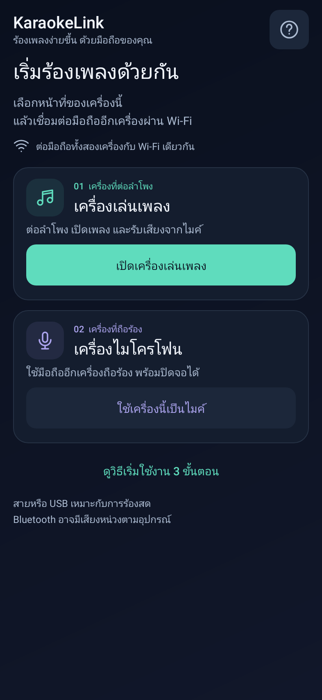

# KaraokeLink

[ไทย](README.md) · [English](README.en.md) · [简体中文](README.zh-CN.md) · [Tiếng Việt](README.vi.md) · [Bahasa Indonesia](README.id.md)

Turn phones into wireless microphones and play karaoke on another phone over the same Wi-Fi. One player supports **two microphones at once**. Use the same APK on all phones. Requires Android 9 or later.

**[Download the latest release](https://github.com/saycodedevelop/FREEMIC/releases/latest)** · [Multilingual changelog](CHANGELOG.md)

## Screenshots



[Microphone](docs/screenshots/microphone.png) · [Mixer](docs/screenshots/mixer.png) · [Setup guide](docs/screenshots/getting-started.png)

Android-rendered previews use simulated state and Thai text. [User guide (Thai)](docs/USER_GUIDE.md).

## Get started

1. Install the APK on the player and each microphone phone; connect all to the same Wi-Fi.
2. On the phone connected to the speaker, choose **Open music player**, then search for a song or paste an HTTPS link.
3. On each singing phone, choose **Use this phone as a mic**, grant microphone/notification permissions, and select the same player.

Skip the first-run guide or reopen it using **?** on any screen.

## Find the player and connect two microphones

Discovery uses Android NSD/mDNS alongside UDP broadcast and confirms the player with unicast probes. Results show the manufacturer/model and IP. Two connected microphones appear as **2/2**; stopping one leaves the other connected.

If discovery fails, tap the player status to find its IP, then choose **Connect by IP** on the microphone. Guest Wi-Fi, AP/client isolation, some hotspots, and VPNs can block communication. Devices must be allowed to contact each other.

## Screen-off microphone

A connected microphone keeps sending audio with its screen off or another app open. Stop from the notification or the in-app **Stop microphone** button. Recording never restarts automatically after reboot or process termination.

The player retains microphone audio and connections in the background. Music from some websites may pause according to the site policy.

## Sound and network

- Each microphone has gain and effects. Noise gate defaults to off and can be enabled in advanced settings.
- Packet reordering, adaptive buffering, short-loss fading, and clock-drift compensation stabilize audio.
- Wired or USB speakers suit live singing; Bluetooth adds device-dependent delay and may stutter.
- HTML5 music volume works only on supported sites. Android mixes the music and microphone audio.
- RTT and queue statistics do not measure mouth-to-speaker latency. Added delay cannot remove Bluetooth delay.
- LAN microphone traffic is currently unencrypted; use a trusted network.

## Languages

Thai, English, Simplified Chinese, Vietnamese, and Indonesian are included. The app follows the phone language, with English as fallback. Choose **Language** on Home or use Android 13+ app-language settings. Change language before starting a session. Release notes include all five languages.

## Installation and development

Official assets are `KaraokeLink-<version>.apk`, signed with a permanent release key, and `SHA256SUMS.txt`. Old previews use a different signing key and require one uninstall; later official releases can update in place.

Use JDK 17 or 21, Android SDK 35, NDK 27.0.12077973, and CMake 3.22.1. Set `JAVA_HOME` and `ANDROID_HOME`, then run:

```powershell
.\gradlew.bat :app:assembleDebug :app:lintDebug :app:testDebugUnitTest
```

Debug APK: `app/build/outputs/apk/debug/app-debug.apk`.

[Architecture (Thai/English)](docs/ARCHITECTURE.md) · [LAN protocol (Thai)](docs/PROTOCOL.md) · [Device testing (Thai/English)](docs/TESTING.md) · [Release process (English)](docs/RELEASING.md)

## Player hotspot and low latency

On the player, open **Sound settings → Player Wi-Fi hotspot → Create player Wi-Fi**. Grant the requested permission and connect each microphone to the displayed Wi-Fi name and password. Return to the microphone app and select the player. Two microphones are still supported. The player service owns the hotspot across Activity recreation and releases it when the player session stops.

The app hotspot does not share Internet; online music may need mobile data, and some phones disconnect their previous Wi-Fi. Use system hotspot settings for Internet sharing or a 5 GHz option.

**Low latency mode** defaults to on. It reduces the initial receive reserve from 30 to 15 ms and the output buffer from four to two bursts; buffering still adapts to jitter and callback size. These are buffer settings, not measured mouth-to-speaker latency. Turn the mode off if audio crackles or drops out. When comparing delay, set added delay to 0 and disable microphone echo/reverb. A hotspot may reduce network variation but cannot remove hardware audio delay.

[Delay testing guide (Thai)](docs/LATENCY.md)

Once the hotspot is ready, its screen displays a **Wi-Fi QR code**. On each microphone, open Wi-Fi settings, scan the player code, confirm connection, then return to KaraokeLink and choose the player. The code is generated locally and updates with the hotspot credentials. No in-app camera permission is needed.

## Full screen, touch lock, and screen-off player

Tap **Full screen** at the lower-right of the web frame to expand the current page without reloading it. In-page video full screen is also supported. Back restores the normal layout without disconnecting microphones.

**Lock touch** displays a black touch-blocking overlay. Taps and Back do not dismiss it; hold **Hold to unlock**. The power button can still turn the screen off.

A foreground player service retains microphone audio, networking, and the app hotspot while the screen is off, another app is open, or the Activity is recreated. Stop through the **Stop player** notification or confirmed in-app Home action. Some websites pause music when backgrounded or screen-off; touch lock keeps the page in the foreground. Website playback is not guaranteed after Activity destruction. Sessions never restart automatically after process termination or reboot.
