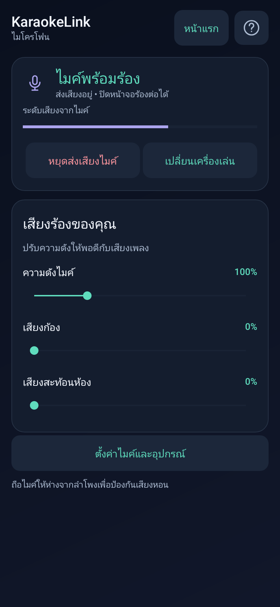
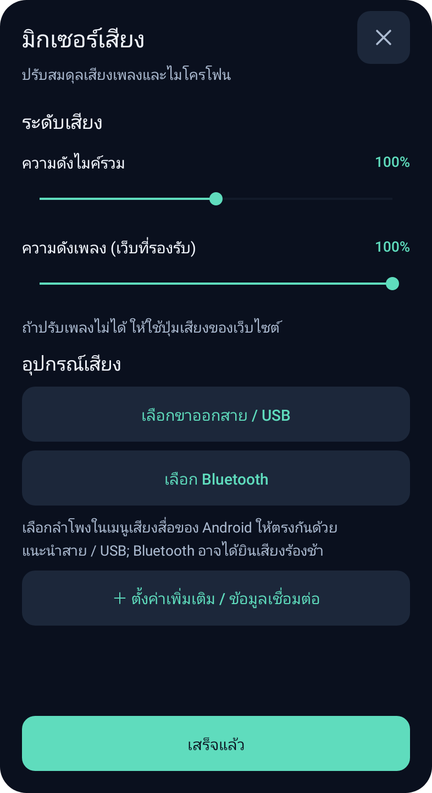

# KaraokeLink

[](https://github.com/saycodedevelop/FREEMIC/actions/workflows/android.yml)
[](https://github.com/saycodedevelop/FREEMIC/releases/latest)

เปลี่ยนมือถือเป็นไมโครโฟนไร้สาย และเปิดเพลงคาราโอเกะบนอีกเครื่อง ผ่าน Wi-Fi เดียวกัน
ใช้ APK เดียวกันทั้งเครื่องเล่นและเครื่องไมค์ รองรับ Android 9 ขึ้นไป

**[ดาวน์โหลดรุ่นล่าสุด](https://github.com/saycodedevelop/FREEMIC/releases/latest)** · [ประวัติการเปลี่ยนแปลง](CHANGELOG.md)

## หน้าจอใหม่

<table><tr>
<td></td>
<td></td>
<td></td>
<td></td>
</tr></table>

ภาพจากการเรนเดอร์ Android ด้วยสถานะจำลอง · [คู่มือผู้ใช้ใหม่](docs/USER_GUIDE.md)

## เริ่มใช้งาน

ครั้งแรกแอปจะแนะนำสามขั้นตอน ข้ามได้ และเปิดซ้ำจากปุ่ม **?** ทุกหน้า

1. ติดตั้ง APK บนมือถือทั้งสองเครื่อง และต่อ Wi-Fi เดียวกัน
2. เครื่องที่ต่อลำโพง: เลือก **เปิดเครื่องเล่นเพลง** แล้วค้นหาชื่อเพลงหรือวางลิงก์ HTTPS
3. เครื่องที่ใช้ร้อง: เลือก **ใช้เครื่องนี้เป็นไมค์** อนุญาตไมโครโฟน/การแจ้งเตือน แล้วเลือกเครื่องเล่น

ถ้าค้นหาเครื่องเล่นไม่พบ ให้ใช้ **หาไม่เจอ? เชื่อมต่อด้วย IP** โดยดู IP จากหน้าเครื่องเล่น
Hotspot ต้องอนุญาตให้อุปกรณ์ติดต่อกันได้

## ร้องต่อขณะปิดหน้าจอ

เมื่อเครื่องไมค์เชื่อมต่อแล้ว สามารถปิดหน้าจอหรือสลับแอปได้ การแจ้งเตือนจะแสดงว่าไมค์กำลังทำงาน
หยุดได้จาก **หยุดไมค์** ในการแจ้งเตือน หรือ **หยุดส่งเสียงไมค์** ในแอป
ไมค์ไม่เริ่มทำงานเองหลังรีบูตหรือ process ถูกปิด

เครื่องเล่นยังพักเสียงเมื่อออกจากแอปหรือปิดหน้าจอ ฟังก์ชันปิดจอนี้ใช้กับ **เครื่องไมค์**

## คุณภาพเสียง

- รองรับไมค์พร้อมกันสองเครื่อง พร้อมระดับเสียงและเอฟเฟกต์บนเครื่องไมค์
- เรียงแพ็กเก็ตที่มาสลับลำดับ มีบัฟเฟอร์แบบปรับตัว การผ่อนเสียงเมื่อข้อมูลหายช่วงสั้น และการชดเชย clock drift
- แนะนำสายหรือ USB สำหรับร้องสด Bluetooth มีความหน่วงและอาจสะดุดจากอุปกรณ์/สัญญาณรบกวน
- Noise gate ปิดเป็นค่าเริ่มต้น หากต้องการลดเสียงรบกวน ปรับได้ใน **ตั้งค่าไมค์เพิ่มเติม**
- ตัวปรับเพลง HTML5 ใช้ได้เฉพาะเว็บไซต์ที่รองรับ เสียงเพลงและไมค์รวมกันผ่าน Android system mixer

ค่า RTT และคิวรับเป็นข้อมูลเครือข่าย ไม่ใช่เวลาเสียงจากปากถึงลำโพง การปรับดีเลย์เพิ่มไม่สามารถลดดีเลย์ Bluetooth
เสียงไมค์ส่งระหว่างอุปกรณ์ใน LAN; โปรโตคอลรุ่นนี้ยังไม่เข้ารหัส ควรใช้เครือข่ายที่ไว้ใจ

## รุ่นและการติดตั้ง

ไฟล์แจกใช้ชื่อ `KaraokeLink-<version>.apk` เป็น release build ที่เซ็นด้วยกุญแจถาวร พร้อม `SHA256SUMS.txt`
จากรุ่น preview เดิมต้องถอนแอปหนึ่งครั้ง เนื่องจากเปลี่ยนกุญแจเซ็น หลังจากนั้นอัปเดต release รุ่นถัดไปทับได้

## สำหรับนักพัฒนา

ใช้ JDK 17 หรือ 21, Android SDK 35, NDK 27.0.12077973 และ CMake 3.22.1
ตั้ง `JAVA_HOME` และ `ANDROID_HOME` ให้ตรงกับเครื่อง แล้วรัน:

```powershell
.\gradlew.bat :app:assembleDebug :app:lintDebug :app:testDebugUnitTest
```

Debug APK อยู่ที่ `app/build/outputs/apk/debug/app-debug.apk`

- [สถาปัตยกรรม](docs/ARCHITECTURE.md)
- [โปรโตคอล LAN](docs/PROTOCOL.md)
- [การทดสอบบนมือถือจริง](docs/TESTING.md)
- [กระบวนการ release](docs/RELEASING.md)