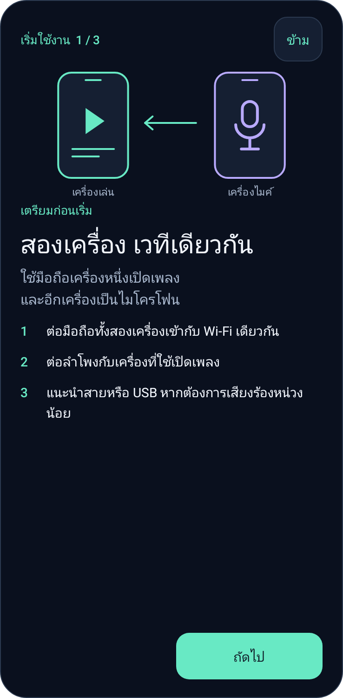

# KaraokeLink

[ไทย](README.md) · [English](README.en.md) · [简体中文](README.zh-CN.md) · [Tiếng Việt](README.vi.md) · [Bahasa Indonesia](README.id.md)

[](https://github.com/saycodedevelop/FREEMIC/actions/workflows/android.yml)
[](https://github.com/saycodedevelop/FREEMIC/releases/latest)

เปลี่ยนมือถือเป็นไมโครโฟนไร้สาย และเปิดเพลงคาราโอเกะบนอีกเครื่อง ผ่าน Wi-Fi เดียวกัน
ใช้ APK เดียวกันทั้งเครื่องเล่นและเครื่องไมค์ รองรับ Android 9 ขึ้นไป

**[ดาวน์โหลดรุ่นล่าสุด](https://github.com/saycodedevelop/FREEMIC/releases/latest)** · [ประวัติการเปลี่ยนแปลง](CHANGELOG.md)

## หน้าจอใหม่

<table><tr>
<td></td>
<td></td>
<td></td>
<td></td>
</tr></table>

ภาพจากการเรนเดอร์ Android ด้วยสถานะจำลอง · [คู่มือผู้ใช้ใหม่](docs/USER_GUIDE.md)

## ภาษา

รองรับภาษาไทย อังกฤษ จีนตัวย่อ เวียดนาม และอินโดนีเซีย แอปใช้ภาษาตามมือถือและใช้ภาษาอังกฤษเมื่อไม่รองรับภาษาของเครื่อง เลือก **ภาษา** ที่หน้าแรกเพื่อบันทึกภาษาที่ต้องการ หรือใช้การตั้งค่าภาษาแอปบน Android 13 ขึ้นไป เปลี่ยนภาษาก่อนเริ่มใช้งานเครื่องเล่นหรือไมค์

## เริ่มใช้งาน

ครั้งแรกแอปจะแนะนำสามขั้นตอน ข้ามได้ และเปิดซ้ำจากปุ่ม **?** ทุกหน้า

1. ติดตั้ง APK บนมือถือทั้งสองเครื่อง และต่อ Wi-Fi เดียวกัน
2. เครื่องที่ต่อลำโพง: เลือก **เปิดเครื่องเล่นเพลง** แล้วค้นหาชื่อเพลงหรือวางลิงก์ HTTPS
3. เครื่องที่ใช้ร้อง: เลือก **ใช้เครื่องนี้เป็นไมค์** อนุญาตไมโครโฟน/การแจ้งเตือน แล้วเลือกเครื่องเล่น

ถ้าค้นหาเครื่องเล่นไม่พบ ให้ใช้ **หาไม่เจอ? เชื่อมต่อด้วย IP** โดยดู IP จากหน้าเครื่องเล่น
Hotspot ต้องอนุญาตให้อุปกรณ์ติดต่อกันได้

## ร้องต่อขณะปิดหน้าจอ

เมื่อเครื่องไมค์เชื่อมต่อแล้ว สามารถปิดหน้าจอหรือสลับแอปได้ การแจ้งเตือนจะแสดงว่าไมค์กำลังทำงาน
หยุดได้จาก **หยุดไมค์** ในการแจ้งเตือน หรือ **หยุดส่งเสียงไมค์** ในแอป
ไมค์ไม่เริ่มทำงานเองหลังรีบูตหรือ process ถูกปิด

เครื่องเล่นคงการเชื่อมต่อไมค์เมื่อออกจากแอปหรือปิดหน้าจอด้วยบริการเบื้องหลัง เพลงจากบางเว็บไซต์อาจพักเองตามนโยบายของเว็บ

## คุณภาพเสียง

- รองรับไมค์พร้อมกันสองเครื่อง พร้อมระดับเสียงและเอฟเฟกต์บนเครื่องไมค์
- เรียงแพ็กเก็ตที่มาสลับลำดับ มีบัฟเฟอร์แบบปรับตัว การผ่อนเสียงเมื่อข้อมูลหายช่วงสั้น และการชดเชย clock drift
- แนะนำสายหรือ USB สำหรับร้องสด Bluetooth มีความหน่วงและอาจสะดุดจากอุปกรณ์/สัญญาณรบกวน
- Noise gate ปิดเป็นค่าเริ่มต้น หากต้องการลดเสียงรบกวน ปรับได้ใน **ตั้งค่าไมค์เพิ่มเติม**
- ตัวปรับเพลง HTML5 ใช้ได้เฉพาะเว็บไซต์ที่รองรับ เสียงเพลงและไมค์รวมกันผ่าน Android system mixer

ค่า RTT และคิวรับเป็นข้อมูลเครือข่าย ไม่ใช่เวลาเสียงจากปากถึงลำโพง การปรับดีเลย์เพิ่มไม่สามารถลดดีเลย์ Bluetooth
เสียงไมค์ส่งระหว่างอุปกรณ์ใน LAN; โปรโตคอลรุ่นนี้ยังไม่เข้ารหัส ควรใช้เครือข่ายที่ไว้ใจ

## รุ่นและการติดตั้ง

ไฟล์แจกใช้ชื่อ `KaraokeLink-<version>.apk` เป็น release build ที่เซ็นด้วยกุญแจถาวร พร้อม `SHA256SUMS.txt`
จากรุ่น preview เดิมต้องถอนแอปหนึ่งครั้ง เนื่องจากเปลี่ยนกุญแจเซ็น หลังจากนั้นอัปเดต release รุ่นถัดไปทับได้

## สำหรับนักพัฒนา

ใช้ JDK 17 หรือ 21, Android SDK 35, NDK 27.0.12077973 และ CMake 3.22.1
ตั้ง `JAVA_HOME` และ `ANDROID_HOME` ให้ตรงกับเครื่อง แล้วรัน:

```powershell
.\gradlew.bat :app:assembleDebug :app:lintDebug :app:testDebugUnitTest
```

Debug APK อยู่ที่ `app/build/outputs/apk/debug/app-debug.apk`

- [สถาปัตยกรรม](docs/ARCHITECTURE.md)
- [โปรโตคอล LAN](docs/PROTOCOL.md)
- [การทดสอบบนมือถือจริง](docs/TESTING.md)
- [กระบวนการ release](docs/RELEASING.md)

## การค้นหาเครื่องเล่นและไมค์หลายเครื่อง

เครื่องเล่น 1 เครื่องรับไมค์พร้อมกันได้ **2 เครื่อง** ให้ติดตั้ง APK รุ่นที่แก้แล้วบนทั้งสามเครื่อง
เปิดโหมดเครื่องเล่นบนเครื่องที่ต่อลำโพง แล้วเลือกเครื่องเล่นเดียวกันบนมือถือไมค์แต่ละเครื่อง
เมื่อเชื่อมต่อครบ เครื่องเล่นจะแสดง **2/2** และหยุดไมค์เครื่องหนึ่งได้โดยอีกเครื่องยังใช้งานต่อ

แอปค้นหาด้วย Android NSD/mDNS ควบคู่กับ UDP broadcast และยืนยันเครื่องเล่นด้วย unicast
หากยังไม่พบ ให้แตะสถานะบนเครื่องเล่นเพื่อดู IP แล้วใช้ «เชื่อมต่อด้วย IP» บนเครื่องไมค์
Wi-Fi สำหรับแขกหรือ AP/client isolation ต้องอนุญาตให้อุปกรณ์คุยกันก่อน

รายการค้นหาแสดงยี่ห้อและรุ่นของเครื่องเล่นพร้อม IP เพื่อแยกเครื่องรุ่นเดียวกัน

## ต่อผ่าน hotspot และลดความหน่วง

บนเครื่องเล่น เปิด **ตั้งค่าเสียง → Wi-Fi hotspot จากเครื่องเล่น → สร้าง Wi-Fi จากเครื่องเล่น** อนุญาตสิทธิ์ที่ขอ แล้วใช้ชื่อ Wi-Fi และรหัสผ่านที่แสดงให้เครื่องไมค์เชื่อมต่อ กลับเข้าแอปบนเครื่องไมค์และเลือกเครื่องเล่นเดิม รองรับไมค์สองเครื่องเช่นเดิม hotspot อยู่ต่อกับบริการเครื่องเล่นเมื่อปิดจอ และหยุดเมื่อยืนยันกลับหน้าแรกหรือกดหยุดเครื่องเล่น

hotspot ที่แอปสร้างไม่แชร์อินเทอร์เน็ต เพลงออนไลน์บนเครื่องเล่นอาจต้องใช้เน็ตมือถือ และบางรุ่นจะตัด Wi-Fi เดิม หากต้องการแชร์เน็ตหรือเลือก 5 GHz ใช้ปุ่มเปิดการตั้งค่า hotspot ของระบบ

**โหมดหน่วงต่ำ** เปิดเป็นค่าเริ่มต้น ลดบัฟเฟอร์รับเริ่มต้นจาก 30 เป็น 15 ms และลดบัฟเฟอร์ขาออกจาก 4 เป็น 2 bursts ระบบยังปรับบัฟเฟอร์ตามสัญญาณและขนาด callback ได้ ตัวเลขนี้ไม่ใช่ความหน่วงรวมจากปากถึงลำโพง ปิดโหมดนี้หากเสียงสะดุด ตอนทดสอบให้ตั้งดีเลย์เพิ่มเป็น 0 และปิด echo/reverb ของไมค์ การใช้ hotspot อาจลดความแปรปรวนของเครือข่าย แต่ไม่ตัดความหน่วงของฮาร์ดแวร์เสียง

[วิธีทดสอบและลดดีเลย์](docs/LATENCY.md)

เมื่อ hotspot พร้อมใช้งาน หน้าจะแสดง **QR เชื่อมต่อ Wi-Fi** บนเครื่องไมค์เปิดการตั้งค่า Wi-Fi แล้วกดสแกน QR จากเครื่องเล่น ยืนยันเชื่อมต่อ แล้วกลับเข้า KaraokeLink เพื่อเลือกเครื่องเล่น โค้ดสร้างในเครื่องและเปลี่ยนตามชื่อ/รหัสผ่านของ hotspot ไม่ต้องให้สิทธิ์กล้องกับแอป

## เต็มจอ ล็อกการสัมผัส และปิดจอเครื่องเล่น

กด **เต็มจอ** ที่มุมล่างขวาของกรอบเว็บเพื่อขยายทั้งหน้าเพลง โดยไม่โหลดเพลงใหม่ รองรับปุ่มเต็มจอของวิดีโอในเว็บด้วย กดย้อนกลับเพื่อย่อกลับโดยไมค์ยังเชื่อมต่ออยู่

กด **ล็อกการสัมผัส** เพื่อเปิดจอดำกันแตะพลาด การแตะสั้นและกดย้อนกลับจะไม่ออก ต้องกดค้างที่ **กดค้างเพื่อปลดล็อก** ปุ่ม Power ยังใช้ปิดหน้าจอจริงได้

เครื่องเล่นใช้บริการเบื้องหลังเพื่อรักษาเสียงไมค์ เครือข่าย และ hotspot เมื่อปิดจอ สลับแอป หรือ Activity ถูกสร้างใหม่ หยุดผ่านการแจ้งเตือน **หยุดเครื่องเล่น** หรือยืนยันกลับหน้าแรกในแอป เพลงจากบางเว็บไซต์อาจพักเมื่อปิดจอ/อยู่เบื้องหลังตามนโยบายเว็บ ให้ใช้ล็อกการสัมผัสหากต้องการให้หน้าเว็บอยู่เบื้องหน้า ระบบไม่เปิด session เองหลังถูกปิด process หรือรีบูต
