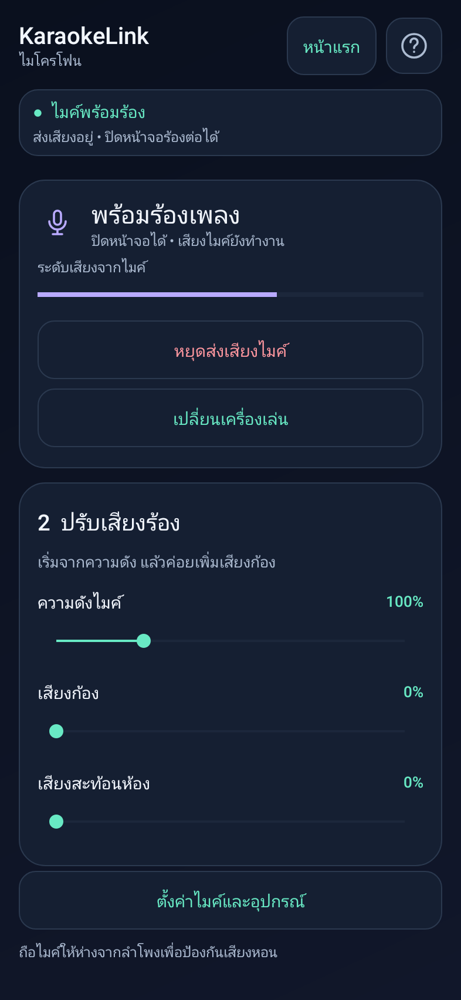
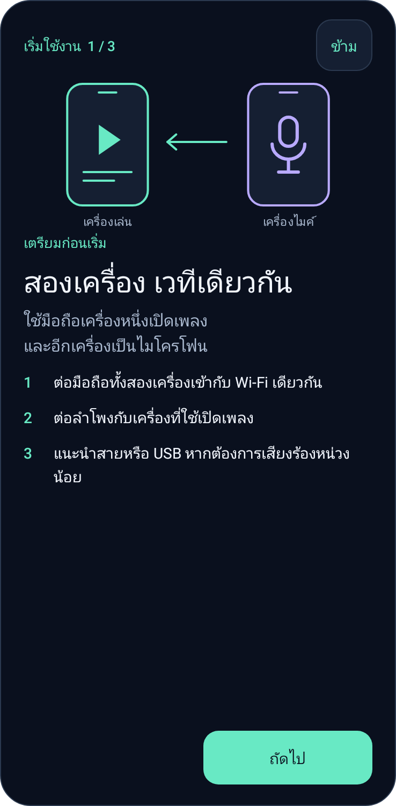

# เริ่มใช้ KaraokeLink

ใช้มือถือสองเครื่อง ติดตั้งแอปเดียวกัน และต่อ Wi-Fi เดียวกัน

## 1. เตรียมเครื่องเล่น

ใช้เครื่องที่ต่อลำโพง แล้วแตะ **เปิดเครื่องเล่นเพลง**
พิมพ์ชื่อเพลงหรือวางลิงก์เพลงในช่องค้นหา จากนั้นกดเล่นวิดีโอบนหน้าเพลง
เปิดหน้านี้ค้างไว้ระหว่างร้อง

## 2. เชื่อมต่อเครื่องไมค์

บนมือถืออีกเครื่อง แตะ **ใช้เครื่องนี้เป็นไมค์**
อนุญาตไมโครโฟนและการแจ้งเตือน แล้วเลือกเครื่องเล่นจากรายการ
รอคำว่า **ไมค์พร้อมร้อง** ก่อนเริ่มร้อง

## 3. ปรับเสียงแล้วเริ่มร้อง

เริ่มความดังไมค์ที่ **100%** และเสียงก้องที่ **0%** แล้วค่อยปรับตามต้องการ
เมื่อเชื่อมต่อแล้ว รายการค้นหาจะยุบลงเพื่อให้เห็นตัวปรับเสียงชัดเจน
ใช้ **เปลี่ยนเครื่องเล่น** ถ้าต้องการดูรายการอีกครั้ง

เครื่องไมค์ปิดหน้าจอร้องต่อได้ ส่วนเครื่องเล่นให้เปิดหน้าจอและหน้าเพลงไว้

## หยุดและเปลี่ยนโหมด

- หยุดเสียงไมค์: **หยุดส่งเสียงไมค์** ในแอป หรือ **หยุดไมค์** ในการแจ้งเตือน
- เปลี่ยนบทบาท: **หน้าแรก** แล้วกดยืนยัน การเชื่อมต่อและเพลงจะหยุด
- วิธีใช้: แตะปุ่ม **?** ด้านบนของทุกหน้า เพื่อเปิดคู่มือสามขั้นตอนอีกครั้ง

## ถ้าค้นหาเครื่องเล่นไม่พบ

1. ตรวจว่าอีกเครื่องเปิด **เครื่องเล่นเพลง** แล้ว
2. ตรวจว่าทั้งคู่ใช้ Wi-Fi เดียวกัน แล้วแตะ **ค้นหาอีกครั้ง**
3. ถ้ายังไม่พบ แตะกล่องสถานะใต้หัวข้อเครื่องเล่นเพื่อดู IP
4. บนเครื่องไมค์ เลือก **เชื่อมต่อด้วย IP** แล้วกรอก IP นั้น

กด **ช่วยเชื่อมต่อ** เพื่ออ่านคำแนะนำในแอป Wi-Fi สำหรับแขกและ Hotspot บางรุ่นอาจปิดการติดต่อระหว่างอุปกรณ์

## อุปกรณ์เสียง

เลือกไมค์ในเครื่อง สาย หรือ USB จาก **ตั้งค่าไมค์และอุปกรณ์** ก่อนเชื่อมต่อ
เลือกขาออกลำโพงจาก **ตั้งค่าเสียง** บนเครื่องเล่น และตั้งขาออกสื่อของ Android ให้ตรงกัน
Bluetooth อาจมีเสียงหน่วง ถ้าต้องการร้องสดด้วยความหน่วงน้อยให้ลองสายหรือ USB

## หน้าจอ

ภาพด้านล่างเรนเดอร์จาก Android Views ด้วยสถานะจำลอง เพื่อแสดงหน้าตาแอป

| หน้าแรก | ไมโครโฟน | เริ่มใช้งาน |
|---|---|---|
|  |  |  |